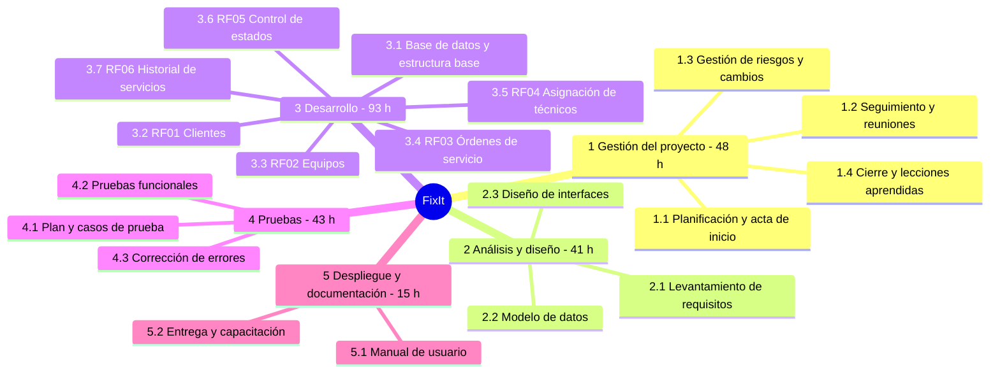

# Estructura de desglose de trabajo (EDT/WBS)

5 paquetes, 19 tareas y 240 horas estimadas.

## Detalle con responsables

| Código | Tarea | Responsable | Horas | Entregable |
| --- | --- | --- | --- | --- |
| 1.1 | Planificación y acta de inicio | Jean | 12 | E1 |
| 1.2 | Seguimiento y reuniones | Julian | 20 | Tablero actualizado |
| 1.3 | Gestión de riesgos y cambios | Julian | 8 | Matriz de riesgos |
| 1.4 | Cierre y lecciones aprendidas | Mariaelis | 8 | E12 |
| 2.1 | Levantamiento de requisitos | Jean | 14 | E2 |
| 2.2 | Modelo de datos | Julian | 14 | E3 |
| 2.3 | Diseño de interfaces | Mariaelis | 13 | E3 |
| 3.1 | Base de datos y estructura base (incluye RF07) | Julian | 10 | Base lista |
| 3.2 | RF01 Clientes | Mariaelis | 12 | E4 |
| 3.3 | RF02 Equipos | Jean | 12 | E5 |
| 3.4 | RF03 Órdenes de servicio | Julian | 19 | E6 |
| 3.5 | RF04 Asignación de técnicos | Jean | 12 | E7 |
| 3.6 | RF05 Control de estados | Jean | 15 | E8 |
| 3.7 | RF06 Historial de servicios | Mariaelis | 13 | E9 |
| 4.1 | Plan y casos de prueba | Mariaelis | 13 | E10 |
| 4.2 | Pruebas funcionales | Los tres | 17 | E10 |
| 4.3 | Corrección de errores | Los tres | 13 | Sistema corregido |
| 5.1 | Manual de usuario | Mariaelis | 8 | E11 |
| 5.2 | Entrega y capacitación | Jean | 7 | E12 |
| | **Total** | | **240** | |

## Carga por integrante

| Integrante | Horas | Horas por semana |
| --- | --- | --- |
| Mariaelis Ortega | 77 | 9,6 |
| Jean Carlos Valverde | 82 | 10,3 |
| Julian Robledo | 81 | 10,1 |

*Fuente: Informe FixIt, Módulo II (Tablas 13 y 14, Figura 2).*
