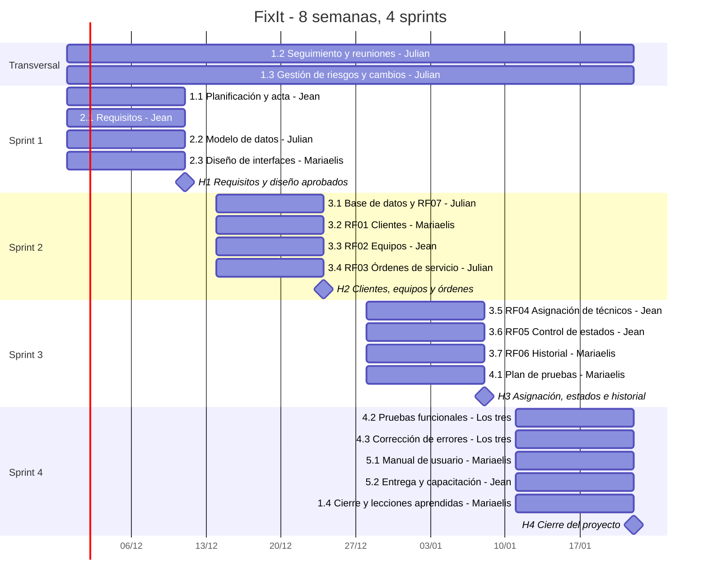

# Cronograma, hitos y diagrama de Gantt

Inicio: lunes 30 de noviembre de 2026. Cierre: viernes 22 de enero de 2027 (supuesto del equipo).
Feriados considerados: 8 de diciembre, 25 de diciembre y 1 de enero.

## Sprints (capacidad: 60 h por sprint)

| Sprint | Fechas | Objetivo | Tareas de la EDT | Horas |
| --- | --- | --- | --- | --- |
| 1 | 30 nov al 11 dic | Planificar, definir requisitos y diseñar | 1.1, 2.1, 2.2, 2.3 | 53 + 7 |
| 2 | 14 al 24 dic | Base del sistema y registro de clientes, equipos y órdenes | 3.1, 3.2, 3.3, 3.4 | 53 + 7 |
| 3 | 28 dic al 8 ene | Asignación, estados e historial, y plan de pruebas | 3.5, 3.6, 3.7, 4.1 | 53 + 7 |
| 4 | 11 al 22 ene | Pruebas, correcciones, manual y cierre | 4.2, 4.3, 5.1, 5.2, 1.4 | 53 + 7 |

## Hitos

| Hito | Descripción | Fecha prevista |
| --- | --- | --- |
| H1 | Requisitos, modelo de datos y prototipos aprobados (E1 a E3) | Viernes 11 de diciembre de 2026 |
| H2 | Módulos de clientes, equipos y órdenes entregados (E4 a E6) | Jueves 24 de diciembre de 2026 |
| H3 | Asignación de técnicos, estados e historial entregados (E7 a E9) y plan de pruebas listo | Viernes 8 de enero de 2027 |
| H4 | Pruebas, correcciones, manual de usuario y cierre completados (E10 a E12) | Viernes 22 de enero de 2027 |

*Fuente: Informe FixIt, Módulo II (Tablas 17 y 18, Figura 3).*
